# Live verification — 2026-11-06

Checkpoint of https://lgme.app after the practice desk, marketplace, SMS chat, media, invoices, the coin page, and the standing donation were on `main`. The tagged commit includes three desk fixes found during this pass and this report.

| Item | Result |
| --- | --- |
| Offline suite | **Pass** — 39 tests, 0 failed, 0 skipped (269 ms) |
| Live HTTP | **Pass** — 44 URLs, all HTTP 200 |
| Internal links and assets | **Pass** — 0 broken internal links, images, video, or icons |
| Headless browser, phone 390×844 | **Pass** — 13 / 13 |
| Headless browser, desktop 1280×800 | **Pass** — 2 / 2 |
| Console errors | **Pass** — 0 |
| `$Trust` | **Pass** — absent |
| Mint and donate strings | **Pass** — exact on `/lgme-coin` |
| Simulation labels | **Pass** — present on the desk and the coin page |

## Offline suite

Command: `node --test test/p2p-exchange-sim.test.mjs` (Node 22).

| | Count |
| --- | --- |
| Pass | 39 |
| Fail | 0 |
| Cancelled | 0 |
| Skipped | 0 |
| Todo | 0 |
| Duration | 269 ms |

## Live HTTP

Every `<loc>` in `https://lgme.app/sitemap.xml` returned 200, plus the practice desk, the coin page, both manifests, and the service worker. The crawl also followed internal `href`, `src`, and `poster` values after script blocks were removed, so template strings inside page scripts were not treated as links.

| Check | Result |
| --- | --- |
| Sitemap URLs (41) | 200 |
| `/p2p-exchange-sim` | 200 |
| `/lgme-coin` | 200 |
| `/manifest.webmanifest` | 200 |
| `/manifest.json` | 200 |
| `/sw.js` | 200, cache name `lgme-v28` |
| Broken internal links or assets | 0 |
| Pages whose text contains `$Trust` | 0 |
| Pages that contain the mint | `/lgme-coin` only |

Sitemap locations, all 200:

`/`, `/balance`, `/bylaws`, `/consciousness`, `/countermeasure`, `/deployment-manifest`, `/developer-notes`, `/disclosures`, `/dominion`, `/dual-pressure-report`, `/exchange`, `/game-theory`, `/grants`, `/hederica`, `/human-nature-synthesis`, `/latch`, `/live-check`, `/membership`, `/mutual-credit-simulator`, `/lgme-coin`, `/p2p-exchange-sim`, `/nswo`, `/operating-system-of-enclosure`, `/opportunity`, `/preparation`, `/pumpup`, `/revelation`, `/reversal`, `/simulation-explainer`, `/sobeit`, `/sobeit-marketing`, `/soverx`, `/spp`, `/story`, `/study`, `/synthesis`, `/technical`, `/the-third-seat`, `/transcript-seat`, `/transcript-study`, `/why-must-we`.

## Browser pass

Headless Chrome against the live origin. Phone viewport 390×844. Desktop viewport 1280×800 (measured content width 1265). Machine-readable results: [verification/e2e-results.json](verification/e2e-results.json).

| Check | Viewport | Result | Evidence |
| --- | --- | --- | --- |
| Splash, then skip | Phone | Pass | Shown, then hidden. [phone-splash.png](verification/phone-splash.png) |
| Simulation banner and `$lgme on pump.fun` → `/lgme-coin` | Phone | Pass | Banner present. Link text and href exact. No `$Trust`. [phone-pin.png](verification/phone-pin.png) |
| Pinned Donation — soBeIT in ihavIT and IwanIT | Phone | Pass | Copy `help grow n floor, thank you.` Action `Receive / send $lgme` href `/lgme-coin`. Simulation legend present. [phone-donation-market.png](verification/phone-donation-market.png) [phone-donation-detail.png](verification/phone-donation-detail.png) |
| Listing → offer → accept → handoff settle | Phone | Pass | Tomato starts, offer 8, accept, same-device settle. Status: `Settled. Buyer 112 · seller 88. SIMULATION.` [phone-handoff.png](verification/phone-handoff.png) |
| SMS token verify and match | Phone | Pass | Same-device record of the signed token, then root-hash match. [phone-chat-match.png](verification/phone-chat-match.png) |
| Media file pick and verify | Phone | Pass | File input, then `Verified. The file matches the tape.` [phone-media-preview.png](verification/phone-media-preview.png) [phone-media-verify.png](verification/phone-media-verify.png) |
| IdidIt invoice → pay → reward | Phone | Pass | Paid invoice. Reward 0.12 on a book that shows 94.12. [phone-invoice.png](verification/phone-invoice.png) [phone-reward.png](verification/phone-reward.png) |
| soBeIT grant | Phone | Pass | `Simulated grant recorded. Balance 99.12. No real funds moved.` [phone-sobeit.png](verification/phone-sobeit.png) |
| Resources | Phone | Pass | Magazine opened. [phone-resources.png](verification/phone-resources.png) |
| Register, KYC, 2FA, send | Phone | Pass | Wrong code rejected. Valid code verified the member and delivered a send. [phone-kyc.png](verification/phone-kyc.png) [phone-send.png](verification/phone-send.png) |
| IOU attest | Phone | Pass | `Attested. The book moved. Bob (Agronomist) 96.12 · Alice (Providore) 113` [phone-iou.png](verification/phone-iou.png) |
| Installability | Phone | Pass | Manifest `https://lgme.app/manifest.webmanifest`. Service worker active at scope `https://lgme.app/`. |
| Coin page strings | Phone | Pass | See the exact-string table. [phone-coin.png](verification/phone-coin.png) |
| Splash and market | Desktop | Pass | Market laid out across the wide viewport. [desk-splash.png](verification/desk-splash.png) [desk-market.png](verification/desk-market.png) |
| Wallet and Resources | Desktop | Pass | Both opened. [desk-wallet.png](verification/desk-wallet.png) [desk-resources.png](verification/desk-resources.png) |
| Console | Both | Pass | 0 errors, 0 warnings |

## Exact strings

Checked on the live coin page, including the buy link:

| String | Where | Result |
| --- | --- | --- |
| `7kqfsEWpiuf3wKJbXkUWpV7RrxpGEbrSTKraRMrppump` | Mint, buy steps, and `https://pump.fun/coin/7kqfsEWpiuf3wKJbXkUWpV7RrxpGEbrSTKraRMrppump` | Exact |
| `6SYznXBadAVkWeAGYKqVDRbiXv5EN1gbJKnf1eT5okLY` | Donate address | Exact |
| Notice | “Real token on Solana. Not financial advice. High risk; you may lose everything. Always verify the mint address. The in-app $lgme balances are a simulation and are not this token.” | Present |
| `$Trust` | Crawled HTML and the browser text of the desk and coin page | Absent |

The practice engine does not embed the mint or the donate address. The desk points at `/lgme-coin` with the pin `$lgme on pump.fun`.

## Fixes found, then re-checked live

The first live pass exposed three desk bugs. They shipped in `0fcf8ef` and the table above is the re-check.

1. Registration locked the signing key before the member check could sign, so the check threw instead of recording. The new wallet now stays unlocked for the session, and a check without a key is refused cleanly.
2. Choosing Market while a listing was open stayed on that listing. Choosing Market or Chats again returns to the list.
3. Dollar IOU controls were hidden on demo books that have no wallet. An unlocked book can record and attest an IOU.

## What was not tested

- The install prompt event (`beforeinstallprompt`) does not fire reliably in headless Chrome. The active service worker, manifest, and icons were checked. The Install control is on the page.
- No second physical phone and no carrier SMS or voice call. Chat was the `sms:` draft plus a same-device token record and a root-hash match. The call control is a `tel:` link. The app does not send the message.
- No physical camera. Media used the file picker, then a hash check against the tape.
- The deep transaction sequence ran at 390×844. Desktop covered the splash, market, wallet, and Resources.
- pump.fun and x.com were not loaded. Only the outbound links were checked.
- The donate QR is drawn by the vendored library. The address string was compared exactly. The QR image was not decoded pixel by pixel.

## Addendum — soBeIT contribution methods

Checked live after the contribution cards shipped, at a 390×844 phone viewport on https://lgme.app. `/lgme-coin` returned HTTP 200. The service worker cache is `lgme-v29`.

| Check | Result |
| --- | --- |
| Heading `soBeIT contributions` | Pass on the coin page, the pinned Donation listing, the soBeIT panel, and the in-app coin panel |
| Pump.fun wallet | Pass. Wallet name `@EgonAnon` is plain text. Solana address `6SYznXBadAVkWeAGYKqVDRbiXv5EN1gbJKnf1eT5okLY` is exact. Copy button and QR are present. |
| pump.fun profile | `https://pump.fun/profile/EgonAnon` returned 403, so the name is not a link |
| X Money | Pass. The card reads `Send via X Money to @Trancesage` and links to `https://x.com/Trancesage` (HTTP 200). It states this is a separate account from the Solana wallet. |
| Risk notice | Present, unchanged |
| `X @EgonomicAnon` | Removed from the coin page |

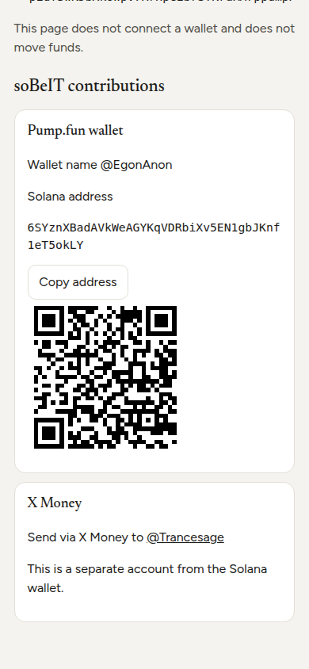

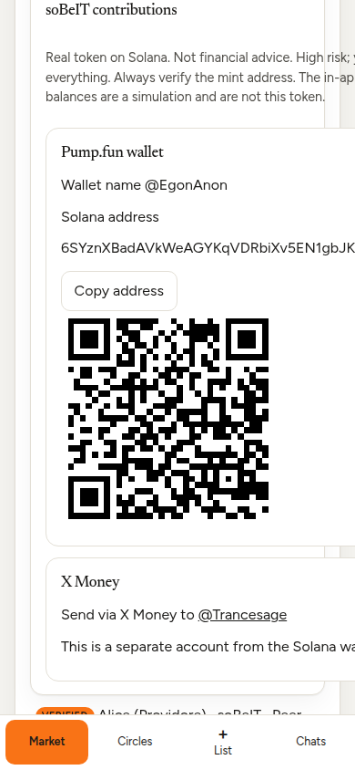

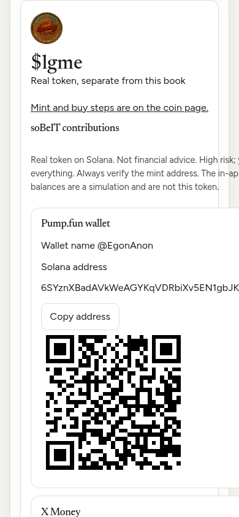

## Addendum — Install & launch

Checked live at 390×844 after the orange control shipped. The homepage, `/p2p-exchange-sim`, and `/lgme-coin` each returned HTTP 200. The service worker cache is `lgme-v30`.

| Check | Result |
| --- | --- |
| Control at the top | Pass. Text `Install & launch`, href `/p2p-exchange-sim`, orange `#F97316`, on all three pages |
| Install prompt | Pass. A click calls `beforeinstallprompt` when the page has one, and stays on the page if the prompt is dismissed |
| No prompt | Pass. The next click opens `/p2p-exchange-sim` |
| Standalone | Pass. With `display-mode: standalone`, the bar is hidden |
| iPhone Safari tooltip | Covered by the decision test: `Share > Add to Home Screen`, then open the desk. A physical iPhone was not used |

The offline suite is 40 pass, 0 fail.

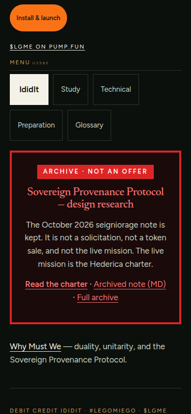

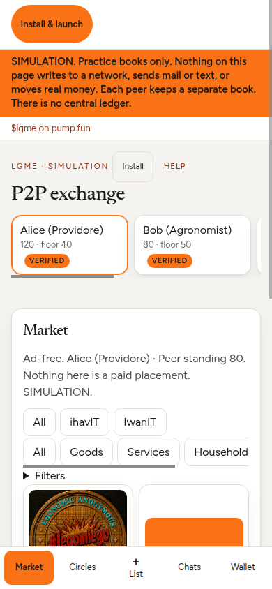

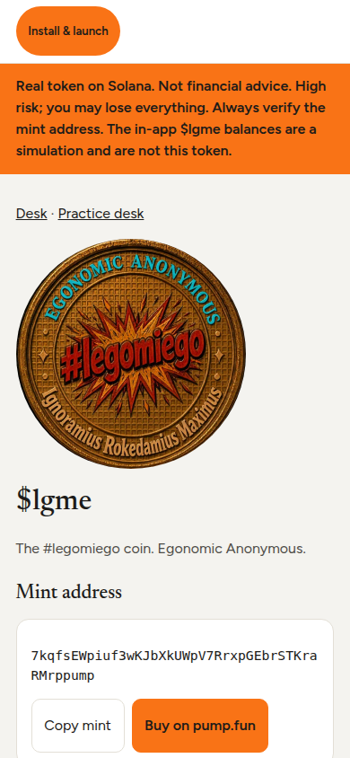

## Addendum — full phone regression, two peers

Headless Chromium at 390×844. Two browser contexts kept separate books and carried signed messages between them. Offline suite at the fixes below: 40 pass, 0 fail. Live result: 47 pass, 1 fail, 0 console errors.

| Check | Result |
| --- | --- |
| 44 sitemap and shell URLs | Pass, all HTTP 200 |
| Every sitemap page opened in the browser | Pass, 41 pages |
| `$Trust` and `EgonomicAnon` | Pass, absent after the name fix |
| Install & launch on `/`, the desk, and `/lgme-coin` | Pass. Prompt stays when dismissed. Otherwise it opens the desk. Hidden in standalone |
| Splash video, manifest, service worker | Pass. Video source `/legomiego-coin.mp4`, muted. Worker active at `https://lgme.app/` |
| Offline reload | Pass. The desk still opened |
| Sign-up, 100 $lgme GENESIS grant, TOTP, wallet unlock | Pass. A wrong code is rejected |
| Unverified send limit 20, then vouch plus 2FA to Verified | Pass |
| Signed file from peer A into peer B, `sms:` and `mailto:` | Pass. Bob imported balance 84 |
| Tape verify, export, and import on the other peer | Pass |
| IOU pending, then attested | Pass. Bob 77, Alice 127 after attestation |
| Floor seniority | Pass. `Floor stays senior` |
| Third-seat refusal | Pass. No penalty. Balances stayed 120, 84, and 70 |
| ihavIT and IwanIT listings, offer, accept, hold | Pass |
| Handoff settlement | Pass. `Settled. Buyer 76 · seller 128. SIMULATION.` |
| Handoff QR decoded by the headless reader | Fail. The code is drawn at 360×360. jsQR did not recover the long `lgme1.` payload |
| Pinned donation, `@EgonAnon`, address, X Money `@Trancesage` | Pass |
| Donate QR on `/lgme-coin` | Pass. Decoded to `6SYznXBadAVkWeAGYKqVDRbiXv5EN1gbJKnf1eT5okLY` |
| Mint | Pass. `7kqfsEWpiuf3wKJbXkUWpV7RrxpGEbrSTKraRMrppump` |
| SMS token and KYC-hash match | Pass. `Matched` |
| `tel:` call log, no audio | Pass |
| Camera capture verify, and a changed file | Pass. `Verified. The file matches the tape.` then `Not authentic` |
| Overdue invoice, partial pay, refusal | Pass. Partial: `Paid 4 $lgme. Remaining 6. Reward 0.` Refusal has no reward |
| soBeIT grant | Pass. Balance 524. No real funds moved |
| Full payment, 2% reward capped at 5, both tapes | Pass. `Paid 300 $lgme. Remaining 0. Reward 5.` |
| Resources magazine and orange `#F97316` | Pass |
| Console errors | Pass. None |

Fixes shipped before the re-check:

- `40cdbb49dc581b972900f43cac838c6e7167b998` — Call opens the note instead of leaving the desk. `EgonomicAnon` is gone from `/pumpup` and `/developer-notes`.
- `f0518a3eb0ebde46d08689e4ec89f31dd4f4c453` — A long handoff QR is drawn at 360 pixels. The headless reader still could not decode it. Settlement itself passed.

Not driven on a physical device: a second phone scanning the handoff QR, a carrier SMS, a placed call, the iPhone Share tooltip, and the browser's own install prompt. The prompt path was a synthetic `beforeinstallprompt`. The fallback really opened `/p2p-exchange-sim`. `getInstalledRelatedApps` did not report an install in headless Chrome.

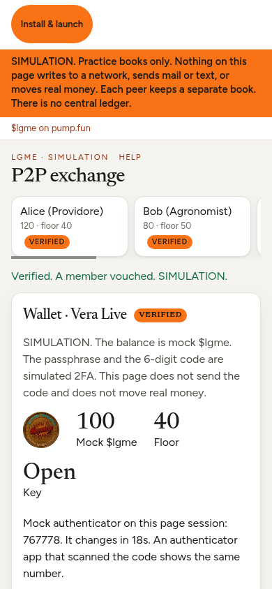

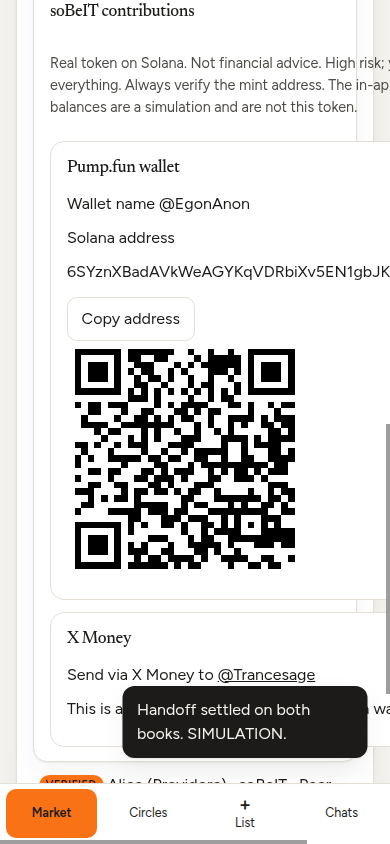

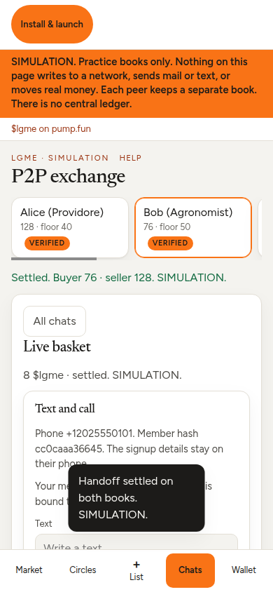

## Addendum — online spends, keys, and serials

Still simulation only. No network write, no blockchain, and no central ledger. Offline suite: 44 pass, 0 fail.

| Check | Result |
| --- | --- |
| Spend while `navigator.onLine` is false | Pass. `Offline is read-only. Open the books, but do not spend, until this browser is online.` |
| Forced second owner of the same serial | Pass. Fraud proof. Floor became 41. Standing 62. The balance did not move again |
| Both peers sign the challenge | Pass, covered by the offline suite. The acknowledgement expires after 10 minutes |
| Device unlock wording | Pass. `fingerprint / face / device PIN (your phone decides)` |
| Handoff QR | Pass. The book stores `lgme1q.` and the rendered code decoded to that token |
| Passkey ceremony on a real phone | Not tested. Headless Chrome did not create a platform authenticator |
| IndexedDB key after a reload, and a real backup file on another phone | Not tested on a device. The backup round trip and non-extractable import passed in the suite |

`main` includes `b5fb500444be47ee078ddc84a7aa85486b7b128d`.

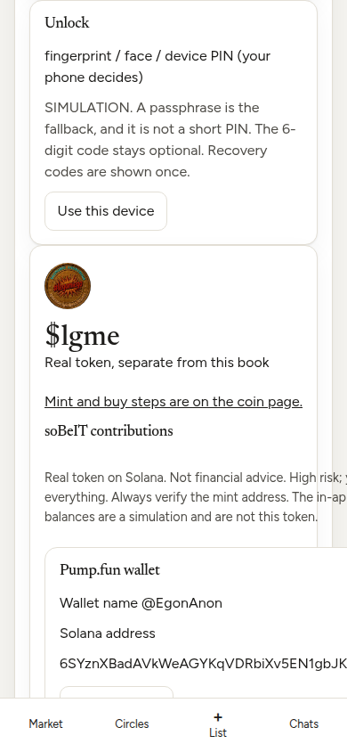

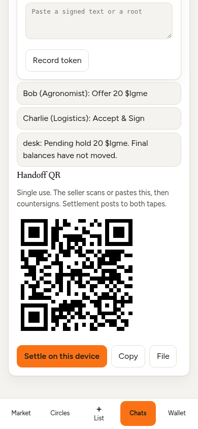

## Addendum — script CSP

`script-src` is `'self'` on the live response. Inline scripts and event-handler attributes were moved into same-origin files. Inline styles stay allowed. The preparation page may still frame YouTube.

Checked live at 390×844 and 1280×800: 47 pages, all HTTP 200, no CSP violations, no console errors. The home menu opens, the mutual-credit simulator still has its execute control, the practice desk opens on Market, and the coin page copy button changes to Copied. The install control still points at `/p2p-exchange-sim`.

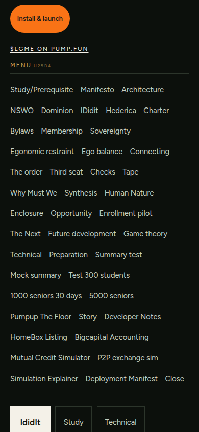

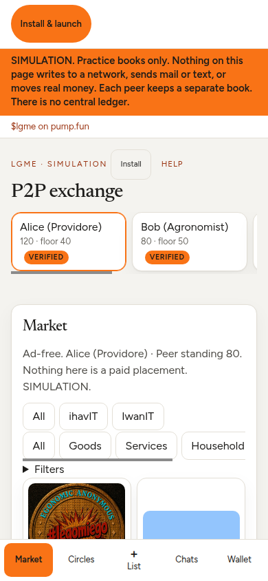

## Addendum — 2026-11-07

Live check of https://lgme.app after the script CSP change. `main` had no open pull requests. Two defects found in this pass were fixed before the tag.

| Check | Result |
| --- | --- |
| Sitemap and shell URLs | Pass. 44 URLs, all HTTP 200 |
| `$Trust` and `EgonomicAnon` | Pass, absent |
| CSP `script-src` | Pass. `'self'` only. `object-src 'none'`, `base-uri 'self'`, `frame-ancestors 'none'`, `upgrade-insecure-requests` |
| HSTS, nosniff, `X-Frame-Options: DENY`, referrer, `camera=(self)` | Pass |
| Console and CSP, 390×844 | Pass. 41 sitemap pages |
| Console and CSP, Pixel 7 412×915 | Pass. 41 sitemap pages |
| Console and CSP, desktop 1280×800 | Pass. 41 sitemap pages |
| Install & launch on `/` and the desk | Pass. First bar, orange, opens `/p2p-exchange-sim` |
| Coin mint, `@EgonAnon`, donate address, X Money `@Trancesage` | Pass |
| Donate QR on `/lgme-coin` | Pass. Decoded to `6SYznXBadAVkWeAGYKqVDRbiXv5EN1gbJKnf1eT5okLY` |
| Passkey wording | Pass. `fingerprint / face / device PIN (your phone decides)` |
| Donation cards on the desk | Pass. Address and “Send via X Money to @Trancesage” |
| Short handoff QR | Pass. Image decoded to `lgme1q.af99f5a9e23cf868b2f9c5` |
| Third-seat co-sign above 50 | Pass. Blocked, then allowed with a co-sign |
| Double-spend | Pass. Fraud proof. Floor 41. The balance did not move again |
| Offline spend | Pass. `Offline is read-only. Open the books, but do not spend, until this browser is online.` |
| IdidIt invoice | Pass. `Invoice signed. The balance did not move.` |
| soBeIT grant | Pass. Balance 65. No real funds moved |
| Offline suite | Pass. 46 tests, 0 failed |

Fixes in the tagged commit:

- The vault write now finishes before the device key is treated as saved. A later visit reuses that key, so a sealed member salt still opens and an invoice can be signed.
- Android 13 was read as an ancient browser, so the QR bitmap was never exported. A major-only version is read as current, and the donate and handoff images decode.

Service worker cache: `lgme-v36`. Verified code: `99abb5b95b88573ccedccd0d95f2244d3c57be85`. Tag: `v-sim-2026-11-07`.

Not driven on a physical device: the platform authenticator (fingerprint, face, or device PIN), a second phone’s camera, a carrier SMS, a placed call, the iPhone Share tooltip, and the browser’s own install prompt.

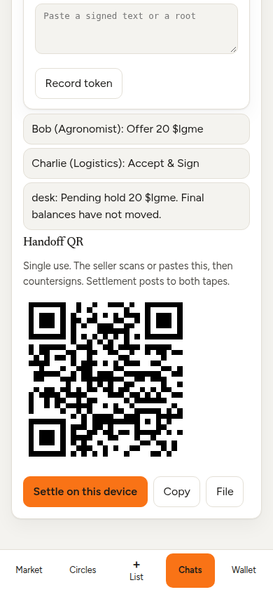
